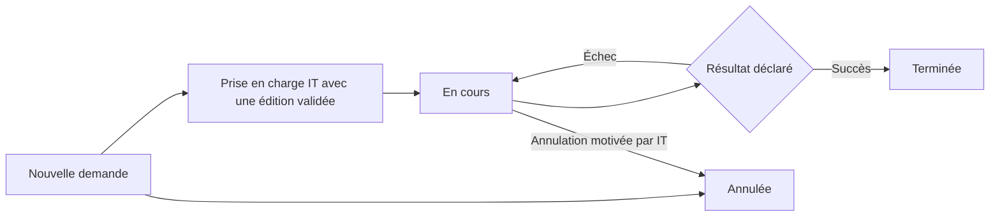

# Demandes d'extraction et bibliothèque des requêtes Oracle

## Intégration

Le module réutilise Spring Boot 3.5.3, Java 17, PostgreSQL/Flyway, Angular 19,
les comptes, profils, départements, services et journaux existants. Il ajoute
un registre de demandes et une bibliothèque SQL versionnée. L'organigramme et
les circuits de signature restent dans leurs modules actuels.

Le portail conserve les requêtes déjà validées. « Validée » correspond à la
validation déclarée par le gestionnaire, avec sa date réelle. L'auteur affiché
est la personne qui enregistre cette édition, sans prétendre identifier son
créateur ou son validateur d'origine. Aucun essai ou résultat d'exécution n'est
fabriqué. Le portail ne se connecte pas à Oracle ; les extractions restent
réalisées dans les outils autorisés puis déclarées par l'opérateur habilité.

Les paramètres nommés favorisent la réutilisation sans réécrire les critères
dans le SQL : voir la [documentation Oracle sur les variables liées](https://blogs.oracle.com/sql/improve-sql-query-performance-by-using-bind-variables).
La distinction entre SELECT et SELECT FOR UPDATE est documentée dans les
[transactions Oracle en lecture seule](https://docs.oracle.com/en/database/oracle/oracle-database/26/lnpcc/database-concepts.html).
Sources consultées le 11 octobre 2026. La vérification locale du catalogue est
un filtre de texte, pas un analyseur Oracle ni une garantie d'absence d'effets
de bord de fonctions SQL. L'exécution réelle reste sous les habilitations Oracle.

## Accès

Menu **Informatique → Requêtes et extractions**, route `/informatique/extractions`.
Le menu et la garde de route utilisent les capacités relues sur le serveur.
Le module fonctionne indépendamment de l'activation des habilitations.

| Permission | Périmètre |
|---|---|
| `EXTRACTIONS_DEMANDER` | Créer, lire et suivre ses propres demandes ; annuler une demande nouvelle |
| `REQUETES_CONSULTER` | Lire et télécharger le SQL des éditions courantes validées et leurs informations ; aucune gestion des demandes |
| `EXTRACTIONS_GERER` | Enregistrement de requêtes validées, anciennes éditions, traces, archives et demandes de tous les départements ; saisie pour un agent |
| `BA_ADMIN` | Gestion et attribution des permissions |
| `SUIVI_DEMANDES_DEPARTEMENT` / `SUIVI_DEMANDES_GLOBAL` | État du traitement dans le suivi commun, sans contenu SQL ni critères d'extraction |

Les rôles actifs du compte et du profil actif sont relus à chaque appel. La
révocation reste effective avec un ancien JWT. Aucun rôle n'est attribué
automatiquement. Être référent d'une plateforme ou membre du département
informatique ne confère aucun de ces droits.

Un demandeur ne reçoit pas les scripts SQL ou les traces techniques par les
réponses de demandes. Un lecteur de bibliothèque voit uniquement l'édition
courante validée ; les éditions antérieures et brouillons sont réservés aux
gestionnaires. Les réponses portent `Cache-Control: no-store`. Les consultations
du détail SQL sont journalisées ; les téléchargements utilisent ce contenu déjà
autorisé et n'ont pas d'URL publique.

## Parcours de la bibliothèque

Le champ facultatif **Mot clé** (`motCle`, 200 caractères maximum) est enregistré
dans la fiche et dans chaque nouvelle édition. Les espaces en début et fin sont
retirés. Un champ absent ou nul devient vide ; les éditions historiques restent
lisibles sans modification de leur contenu. Le frontend conserve ce champ lors
d'une modification ou d'une duplication et l'affiche dans les résultats et le détail.

La recherche serveur `GET /api/extractions/requetes?recherche=rapprochement`
cherche une partie du **titre, de l'objectif ou du mot clé**, sans distinguer
majuscules et minuscules. `%`, `_` et `\` sont recherchés comme du texte littéral.
Elle conserve les filtres de département, de visibilité et la pagination.
La migration **V1.36__mot_cle_requetes.sql** ajoute la colonne `mot_cle` avec une
valeur vide pour les fiches existantes ; elle s'applique au démarrage du backend.

1. **Requêtes validées → Enregistrer une requête** : renseigner le titre,
   le département demandeur, l'objectif, le SQL et sa date de validation (passée ou actuelle).
   Le champ **Service demandeur (facultatif)** propose les services actifs du
   département choisi. Changer de département efface la sélection du service.
2. **Enregistrer la requête validée** crée une édition immédiatement disponible,
   sans code unique ni plateforme source. Le département demandeur est choisi
   dans l’annuaire des départements actifs, même sans agents. Son identité et
   son nom sont conservés dans la fiche et chaque édition ; le serveur ignore
   tout nom de département ou de service proposé par le client. Si un service est
   renseigné, le serveur vérifie qu'il est actif et rattaché à ce département,
   puis conserve son identité et son nom dans la fiche et l'édition.
   L'auteur réel de saisie est calculé
   par le serveur. Aucun essai n'est requis pour cet enregistrement.
3. Copier ou télécharger le fichier SQL depuis la fiche. Le nom du fichier
   provient du titre nettoyé et du numéro d'édition ; il ne constitue pas un
   identifiant unique. Plusieurs fiches peuvent avoir le même titre.
4. **Nouvelle édition** enregistre une correction déjà validée avec sa date.
   L'ancienne édition reste immuable. **Dupliquer** crée une fiche distincte,
   sans reprendre sa version technique ni imposer un titre différent.
5. **Archiver** exclut la fiche des nouvelles prises en charge sans effacer
   l'historique. **Restaurer** la laisse à revoir : enregistrer une nouvelle
   édition avec une validation réelle pour la remettre à disposition.

Le schéma Oracle, le commentaire d'édition et la description des paramètres
sont regroupés dans **Informations complémentaires (facultatif)**. Les variables
:nom peuvent être conservées sans décrire leurs types. Si une liste de paramètres
est renseignée, elle doit correspondre exactement au SQL : noms distincts sans
tenir compte de la casse, type (texte, date, nombre), description, maximum 30.
Le serveur ne crée pas de types ou de valeurs de paramètres supposés.

Le SQL est limité à 50 000 caractères. Le filtre accepte une seule extraction
SELECT, avec WITH et paramètres nommés, et refuse scripts multiples, écritures,
PL/SQL, SELECT INTO et FOR UPDATE. Les commentaires, littéraux ordinaires,
littéraux Oracle q'[...]' et identifiants entre guillemets sont distingués
des mots-clés. Ces contrôles ne remplacent pas une validation Oracle réelle.

Les traces d'essais historiques restent consultables. Les endpoints anciens
/essais et /verifier sont conservés pour compatibilité : déclarer un échec peut
retirer une édition de la réutilisation ; /verifier exige toujours un dernier
essai daté réussi de l'édition concernée. Ils ne sont plus des étapes du formulaire.

## Parcours d'une demande



1. Le demandeur remplit titre, date de demande, objectif, échéance facultative,
   période de données facultative et critères attendus. Le département provient
   de son rattachement actif, sans sélection libre. L'auteur de saisie et la date
   d'enregistrement proviennent du serveur.
   **Service demandeur** reprend le service actuel de l'agent, lorsqu'il est actif
   et rattaché à ce département. Il est possible de sélectionner un autre service
   du même département ou **Service non précisé / tout le département**.
2. Le gestionnaire peut enregistrer pour un autre agent actif rattaché à un
   département. L'auteur de saisie reste le gestionnaire connecté. Les noms du
   demandeur, du département et du service sont conservés tels qu'enregistrés.
   Changer de demandeur réinitialise le service à celui du nouvel agent ; un service
   d'un autre département est refusé même par appel direct à l'API.
3. Une **Nouvelle** demande peut être annulée par son demandeur ou l'IT, avec un
   motif. Pour corriger un besoin déjà enregistré, annuler puis créer la demande
   corrigée ; aucun endpoint ne réécrit silencieusement le besoin initial.
4. **Prendre en charge** choisit une édition validée et fige sa copie dans la
   demande. L'opérateur connecté devient responsable du traitement. Une demande
   ne peut pas être prise en charge deux fois.
5. Ce responsable réalise l'extraction dans son outil Oracle autorisé, puis
   utilise **Déclarer l'exécution**. La date doit suivre la date de demande.
   La référence de vérification peut désigner un ticket ou un journal de contrôle.
   Les paramètres attendus sont documentés dans la copie SQL ; les critères
   concrets restent ceux du besoin enregistré.
6. Un succès termine la demande une seule fois. Un échec conserve **En cours** ;
   si l'édition est encore courante, un dernier essai daté en échec retire sa
   disponibilité dans la bibliothèque. Un succès ultérieur permet de terminer
   la demande ; le retour dans la bibliothèque passe par une nouvelle édition déjà validée
   (ou par l'API historique de vérification après succès).
7. Les demandes en cours ou terminées gardent leur édition initiale lorsque la
   bibliothèque évolue ou est archivée. Le SQL de cette édition est visible dans
   leur détail pour l'IT. Une demande terminée ne peut pas être annulée ou faire
   l'objet d'une seconde clôture. L'IT peut annuler une demande en traitement.

Ce parcours est un suivi de travail informatique, pas une approbation RH ou
bancaire. Aucun accord de chef, directeur, DGA ou DG n'est supposé. Si une
validation métier préalable est obligatoire, utiliser la démarche et le
circuit existants prévus par la banque avant le traitement ; définir séparément
ce besoin avant d'en automatiser la liaison. Aucun nouveau moteur de signature
n'est ajouté.

Ne pas déposer les fichiers extraits, données de clientèle, mots de passe,
chaînes de connexion ou secrets dans les champs libres. Les résultats sont
livrés via le canal déjà autorisé par la banque ; le portail conserve la trace.

## Suivi, audit et concurrence

`V1.30__demandes_extraction_requetes_oracle.sql` crée quatre tables :
`ba_requete_oracle`, `ba_requete_revision`, `ba_extraction_demande` et
`ba_extraction_execution`. Les références sont des clés étrangères aux
référentiels existants. Les éditions et exécutions sont ajoutées sans endpoint
de modification/suppression. Les événements de traitement conservent date,
auteur réel, action et motif. `ba_log` trace aussi les opérations et vérifications.

La version technique d'une fiche est distincte de l'édition SQL : un essai ou
une vérification fait varier la première sans changer le SQL. Un enregistrement
de contenu crée une édition. Les versions lues sont obligatoires sur les
opérations ; un conflit renvoie 409. Le verrouillage PostgreSQL sérialise les
modifications et protège les exécutions concurrentes. Deux envois de la même
version ne produisent qu'un seul effet métier ; la seconde tentative est refusée.
Après un conflit, recharger la fiche. La saisie en cours est conservée tant que
l'utilisateur ne choisit pas de recharger ou d'annuler.

Le suivi commun utilise la permission de suivi et le département actuel du
demandeur, conformément aux autres modules. La demande métier conserve son
département d'origine. Les demandes nouvelles/en cours figurent dans le filtre
**En validation ou en traitement** ; leur état précis apparaît dans l'étape
active. La fin d'extraction est **Terminée**, sans inventer une approbation ou
un signataire. Les suivis ne montrent ni titres, objectifs, critères, SQL,
paramètres ni références de livraison.

## API

Toutes les routes `/api/extractions` sont authentifiées et contrôlées au serveur.

| Méthode / chemin | Utilisation |
|---|---|
| GET `/configuration` | Capacités et références disponibles |
| GET `/requetes` | Filtres `recherche` (titre/objectif/mot clé), `departementId`, `brouillons`, `archivees`, `page`, `size` |
| GET `/requetes/{id}` | Détail SQL, paramètres, 50 dernières éditions/traces au maximum |
| POST `/requetes` / PUT `/requetes/{id}` | Enregistrer une requête déjà validée / ajouter une édition avec version ; commentaire facultatif |
| POST `/requetes/{id}/essais` | Compatibilité historique : déclarer un essai de l'édition courante, version obligatoire |
| POST `/requetes/{id}/verifier` | Compatibilité historique : vérifier après essai réussi, version et motif |
| POST `/requetes/{id}/archiver` / `/restaurer` | Retrait logique / restauration, version et motif |
| GET `/demandes` | Filtres `recherche`, `etat`, `departementId` (IT), `page`, `size` |
| GET `/demandes/{id}` | Besoin, état et historique selon le périmètre |
| POST `/demandes` | Enregistrer le besoin ; département/auteur calculés au serveur |
| POST `/demandes/{id}/prendre` | `{version, requeteId, motif}` ; édition courante validée |
| POST `/demandes/{id}/executions` | Déclarer le résultat de l'édition figée, version obligatoire |
| POST `/demandes/{id}/annuler` | Annulation autorisée, version et motif |

Corps minimal d'un enregistrement POST /requetes :

```json
{
  "titre": "Opérations par période",
  "objectif": "Contrôle des opérations du département demandeur",
  "dateValidation": "2026-10-10",
  "departementId": "identifiant-du-departement-actif",
  "sqlTexte": "SELECT :date_debut FROM dual"
}
```

Un PUT ajoute la version technique lue. L'API ignore les anciens champs code et
plateformeId, y compris dans les copies JSON historiques, sans les utiliser.

Les écritures `/requetes` et `/demandes` acceptent aussi `serviceId`, facultatif.
Omettre ce champ, envoyer `null` ou une chaîne vide conserve un besoin sans
service précis. `/configuration` expose les services actifs avec leur
`departementId` ; un demandeur sans accès à la bibliothèque ne reçoit que les
services de son département. La fiche de requête expose `serviceDemandeur`, la
fiche d'extraction `service`, et les éditions conservent `serviceId`/`serviceNom`.

Pagination : 20 par défaut, maximum 100. Les listes ne retournent jamais le SQL.
Les dates de demande/période sont des dates locales ; les horodatages d'exécution
et d'audit sont des instants. Le jour métier d'une exécution est contrôlé dans
`Africa/Ouagadougou` ; le navigateur affiche les heures dans son fuseau local.

## Installation et reprise

1. Sauvegarder PostgreSQL, arrêter les anciennes instances et déployer le backend
   contenant V1.34. Vérifier Flyway puis la validation JPA (`ddl-auto: validate`).
2. Déployer `bsic-frontend/dist/bsic-frontend/browser`.
3. Dans **Utilisateurs → Voir détails → Gestion des rôles**, attribuer les
   permissions nécessaires, puis actualiser/reconnecter les sessions.
4. Reprendre uniquement les SQL déjà validés : préciser titre, objectif et date
   réelle de validation. L'opérateur de reprise est conservé comme auteur de
   saisie, sans inventer le créateur historique ni une exécution.

V1.31 conserve les anciennes valeurs de code et de plateforme en base, rend ces
colonnes facultatives et retire l'index unique du code. Les anciennes révisions,
exécutions et demandes restent inchangées. L'auteur de l'édition courante est
repris lorsqu'il est connu ; la date de validation reste vide pour les anciennes
fiches et s'affiche comme non renseignée. Les anciennes éditions à revoir ne sont
pas converties automatiquement en éditions validées. Aucune migration déjà
publiée n'est modifiée. V1.32 ajoute le département demandeur : aucun département n’est déduit pour les
anciennes fiches ou révisions. À leur prochaine modification, le gestionnaire
choisit le département réel.

V1.34 ajoute le service demandeur facultatif aux requêtes et aux demandes, avec
clés étrangères vers `ba_service` et noms conservés à la saisie. Les anciens
enregistrements restent **Service non renseigné** : aucun service n'est déduit
du rattachement actuel du demandeur et aucune ancienne révision n'est réécrite.
Un changement de nom, de département ou de statut dans l'annuaire ne modifie pas
le service affiché dans une ancienne demande ou édition. Si ce service n'est
plus disponible, une nouvelle édition exige de choisir un service actif du
département ou de retirer la sélection. Redémarrer le backend pour appliquer
V1.34 via Flyway, puis installer le frontend compilé.

Aucune connexion Oracle, donnée de démonstration ou approbation historique n'est
injectée. La migration conserve les autres modules et élargit leur vue de suivi.
Il n'existe pas de migration inverse : conserver les tables et historiques,
privilégier une correction vers l'avant et tester toute restauration sur une copie.

## Recette

Les tests couvrent le contrôle du SQL et des paramètres, les droits API et
révocations, l'absence de SQL dans les demandes personnelles et le suivi,
les dates, l'enregistrement direct sans code/source, les métadonnées facultatives,
les services inactifs ou hors département, les noms de services conservés après
renommage/déplacement, la migration sans reconstitution du passé,
les anciennes copies JSON, la déclaration d'échec, la compatibilité après succès, le changement
d'édition, la conservation d'une ancienne édition dans une demande, l'archivage,
les conflits, les exécutions simultanées et l'annulation. Les tests PostgreSQL
utilisent des schémas temporaires distincts, jamais le schéma applicatif.

Les tests Angular couvrent droits de navigation, périmètres, formulaires,
département automatique, sélection du service liée au département, préremplissage
selon le demandeur, services retirés et noms historiques, duplication,
saisie conservée sur conflit, sélection
des éditions validées, double enregistrement, rendu texte du SQL,
téléchargement `.sql`, révocation et suivi sans signature inventée.

Les résultats de la vérification complète figurent dans le compte rendu de
livraison et les journaux `target/extraction-services-verify.log`,
`bsic-frontend/tmp/extraction-services-tests.log` et `extraction-services-build.log`.
La recette visuelle manuelle reste à effectuer dans l'application.

Vérification du 12 octobre 2026 : **276 tests backend dans 29 suites**, aucun
échec, erreur ou test ignoré (`mvn.cmd -q verify`) ; **211 tests Angular réussis**
(`ng test --watch=false --browsers=ChromeHeadless`) ; build de production réussi.
Le JAR et le frontend compilés ont été générés. La migration n'a pas été appliquée
au schéma applicatif pendant ce travail, et aucun rôle n'a été attribué en base réelle.
