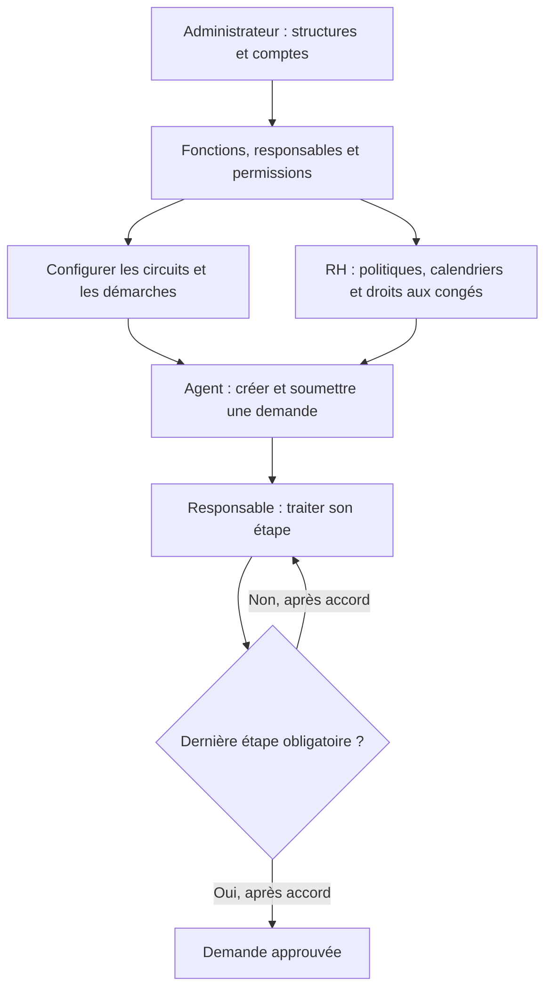
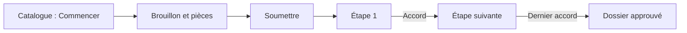
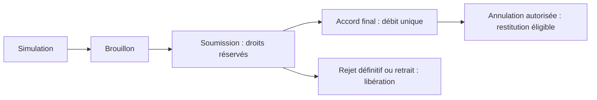
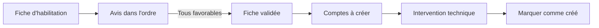

# Guide d'utilisation du portail BSIC

Parcours vérifiés dans le code et les menus le 9 octobre 2026 ; vue workflow,
suivi par périmètre, catalogue informatique avec manuels et extractions Oracle ajoutés le 11 octobre 2026.
Signature personnelle et actes PDF harmonisés ajoutés le 14 octobre 2026.
Ce guide explique où aller, qui intervient et ce qui se passe après chaque action.
Il ne signifie pas que toutes les permissions et politiques sont déjà configurées
dans votre base.

## 1. Par où commencer ?

**Administrateur :** commencer par l'organigramme et les comptes, puis configurer
les circuits et les permissions.

**Agent :** choisir le module correspondant au besoin, remplir la demande,
l'envoyer, puis consulter son état.

**Responsable :** ouvrir la liste des demandes à valider du module concerné,
consulter le dossier, puis approuver l'étape ou refuser avec un motif.
Enregistrer d'abord sa signature dans **Mon compte → Ma signature**.

**RH :** configurer les politiques, calendriers et droits avant l'utilisation
des congés ; suivre ensuite les contrôles administratifs et le planning.

### Ma signature et les actes générés

Chaque agent connecté dispose du menu **Mon compte → Ma signature**, également
accessible dans la barre supérieure. Importer une image **PNG, JPEG/JPG, WebP, BMP,
GIF fixe ou TIFF/TIF à une seule page**, de **2 Mo maximum**,
vérifier l'aperçu puis cliquer sur **Enregistrer ma signature**. Le fichier doit être
une photo ou un scan lisible de sa propre signature sur fond blanc ou transparent.
Le serveur contrôle le contenu de l'image, supprime les métadonnées, recadre les
marges et rend le fond blanc transparent.

L'aperçu avant enregistrement est produit par le serveur, y compris pour les TIFF
que le navigateur ne sait pas afficher directement. Une image vide, illisible,
animée ou multipage est refusée. Le format réel du fichier est contrôlé, même si
l'extension ou le type annoncé est différent.

**Dimensions à l'import :** au moins 20 × 10 pixels ; au plus 4096 pixels par côté
et 12 mégapixels. Après recadrage, l'image est convertie en PNG transparent et
réduite à **900 × 300 pixels maximum**, en conservant ses proportions.

**Dimensions sur chaque acte :** la signature tient dans une zone de
**60 mm de large × 20 mm de haut maximum**, limitée aussi par la largeur disponible
dans le bloc du validateur. Les signatures très larges ou très hautes sont réduites
proportionnellement, sans déformation ni dépassement. Les petites images ne sont
pas agrandies. Le format du fichier et sa résolution d'impression ne changent pas
cette limite physique.

La signature est obligatoire pour approuver une étape de congé, d'absence, de sortie,
de démarche, d'habilitation ou de réinitialisation, ainsi que pour valider une reprise
de service. Le refus conserve son motif et n'appose pas de signature d'approbation.

À chaque approbation, l'image, l'identité et la date du validateur effectif sont
copiées dans le visa de la demande. Lors d'une délégation, il s'agit de la signature
du délégataire ayant réellement validé. **Remplacer ou retirer la signature personnelle
ne modifie pas les visas déjà enregistrés.** Aucun administrateur ne peut importer
une signature pour un autre compte via ce menu.

Les actes PDF comprennent l'identité de l'agent, la référence, le statut, la période
et les visas successifs. Après l'approbation finale, **Télécharger l'acte signé** est
disponible pour les absences et les dossiers du catalogue des démarches. Les congés,
sorties, habilitations et reprises conservent leur téléchargement habituel avec le
nouveau format. Une validation historique sans image archivée le mentionne explicitement ;
la signature actuelle n'est jamais ajoutée rétroactivement. Une sortie encore en attente
ou un congé annulé porte un statut provisoire ou historique visible.

L'image est privée au compte ; les participants autorisés voient les visas dans
l'acte. Il s'agit d'une signature manuscrite numérisée, sans signature électronique
certifiée. La migration Flyway **V1.35** crée les tables nécessaires au prochain
démarrage du backend. Déployer le backend et le frontend ensemble.

Ce schéma présente le parcours d'accord. Un refus suit la règle configurée pour
le module ; il peut rejeter le dossier ou laisser un autre validateur statuer.

## 2. Comprendre les trois mots des démarches

| Mot | Signification | Exemple illustratif |
|---|---|---|
| Circuit | Modèle décrivant qui doit valider et dans quel ordre | Contrôle du document → Validation finale |
| Démarche | Type de demande, avec son formulaire et un circuit publié | Transmission de document |
| Dossier | Demande réelle créée par un agent | Transmission du document du 9 octobre |

**Créer un circuit ne crée pas une demande.** Il faut le publier, l'affecter à
une démarche, puis un agent doit commencer un dossier dans le catalogue.
Un même circuit publié peut être affecté à plusieurs démarches.

## 3. Première configuration : administrateur

### Administrateur initial au premier déploiement

Le backend peut créer automatiquement le premier compte administrateur après
les migrations. Au premier déploiement, définir :

| Paramètre d’environnement | Valeur |
|---|---|
| `APP_BOOTSTRAP_ADMIN_ENABLED` | `true` |
| `APP_BOOTSTRAP_ADMIN_EMAIL` | Votre e-mail administrateur, ou `admin@bsic.bf` par défaut |
| `APP_BOOTSTRAP_ADMIN_PASSWORD` | Le mot de passe choisi au déploiement, au moins 12 caractères |
| `APP_BOOTSTRAP_ADMIN_TELEPHONE` | Un téléphone valide, obligatoire et unique |

Ouvrir ensuite **Connexion**, saisir cet e-mail et le secret de déploiement,
choisir le mot de passe personnel obligatoire et se reconnecter, puis créer
les structures et comptes selon le tableau ci-dessous. Le rôle `BA_ADMIN` est
attribué au compte initial ; aucune fonction hiérarchique n’est supposée.

Un administrateur déjà présent bloque toute nouvelle création automatique :
son mot de passe n’est jamais remplacé au redémarrage. Après l’installation,
désactiver le paramètre d’initialisation et retirer son secret de l’environnement.
Le compte reste utilisable avec son mot de passe courant.

Voir [ADMINISTRATEUR-INITIAL.md](ADMINISTRATEUR-INITIAL.md) pour le lancement Windows,
les variables de déploiement, les contrôles et la procédure de reprise.

### Créer les structures et les comptes

Suivre cet ordre une première fois, puis compléter selon les besoins.

| Ordre | Menu | Action | Résultat attendu |
|---|---|---|---|
| 1 | Annuaire → Départements | Créer les directions/départements | Les structures apparaissent dans les listes |
| 2 | Annuaire → Services | Créer chaque service et choisir son département | Le rattachement du service est correct |
| 3 | Annuaire → Agences | Créer les agences utilisées, si nécessaire | Les agences peuvent être sélectionnées |
| 4 | Utilisateurs → Utilisateurs | Créer les agents et responsables | Fonction et rattachements renseignés |
| 5 | Utilisateurs → Gestion des DGA | Créer/rattacher les DGA aux pôles Opérations et Développement | Un titulaire disponible par pôle, aux dates utiles |
| 6 | Utilisateurs → Gestion du DG | Créer le DG lorsque son étape est obligatoire | Un seul DG actif et disponible |
| 7 | Utilisateurs → Utilisateurs | Attribuer les rôles/permissions nécessaires aux comptes | Chaque personne peut utiliser son espace |
| 8 | Démarches de la banque → Studio des circuits | Configurer, simuler et publier les circuits | Une version publiée est disponible |
| 9 | Démarches de la banque → Catalogue et mes dossiers | Affecter les versions aux démarches | Les démarches activées sont visibles aux agents |
| 10 | Demandes RH → Congés et planning → Gestion RH | Les personnes RH habilitées configurent les congés | Politique, calendrier, affectation et droits disponibles |

Dans le formulaire utilisateur, choisir la **fonction réelle** : agent, chef de
service, directeur, DGA ou DG. Le rôle technique `BA_ADMIN` sert à administrer ;
il ne transforme pas la personne en directeur ni en signataire RH.

Un agent peut être créé dès que son département et son service sont actifs et
cohérents. Les champs de supérieur direct/chef ne sont pas obligatoires pour
créer son compte. Les responsables doivent toutefois exister avant la soumission
d'une demande qui nécessite leurs décisions.

Pour les DGA, vérifier les dates des affectations. Les deux pôles doivent avoir
des titulaires distincts. Pour remplacer un responsable, conserver son historique
et mettre à jour ses dates/son activation selon l'écran prévu.

### Remettre ou réinitialiser un accès utilisateur sans e-mail

À la création d’un compte, une fenêtre affiche son identifiant et un code temporaire
à usage unique. Le remettre directement après vérification de l’identité. Il est
valable 24 heures par défaut ; l’utilisateur doit choisir un mot de passe personnel
avant d’accéder aux modules, puis se reconnecter.

Pour un compte existant, ouvrir **Utilisateurs → Utilisateurs**, puis cliquer sur
l’**icône de clé « Réinitialiser l’accès »** dans sa ligne. L’action existe aussi
dans **Voir détails → Sécurité du compte**. Saisir un motif et générer le code.
Les anciennes sessions sont immédiatement invalidées. Aucun e-mail n’est envoyé.
Le code n’est pas récupérable après fermeture : en générer un nouveau s’il est perdu.

L’action est réservée à **BA_ADMIN** et ne réactive pas un compte verrouillé ou
désactivé. Pour son propre compte, utiliser **Mon mot de passe** dans le menu.
La page de connexion invite à contacter l’administrateur en cas d’oubli.

Voir [ACCES-TEMPORAIRES.md](ACCES-TEMPORAIRES.md) pour les étapes, délais et contrôles.

### Utiliser l’annuaire

Ouvrir **Annuaire → Annuaire global** pour consulter les contacts internes.
La page d’accueil propose le même outil avec les contacts autorisés dans la vue publique.

1. Saisir un nom, plusieurs mots ou un téléphone : les accents et les espaces
   dans les numéros ne bloquent pas la recherche.
2. Choisir un **département**, un **service**, une **agence** et, au besoin,
   une **fonction**. Les services et agences proposés correspondent au département
   choisi ; un choix incompatible est effacé lors du changement de département.
3. Choisir **Cartes** ou **Liste**, puis le tri par nom ou département.
   Le nombre de contacts et la pagination correspondent à la sélection affichée.
4. Cliquer sur le nom ou **Voir la fiche contact** : la fenêtre regroupe fonction,
   département, service, agence, e-mail, téléphone et poste. Les liens permettent
   d’ouvrir la messagerie ou de lancer un appel dans l’outil configuré sur votre appareil.
5. Utiliser **Copier les coordonnées** pour copier les informations de cette fiche.
   **Effacer les filtres** réinitialise la recherche ; sur l’accueil public, les
   contacts sont masqués jusqu’à une nouvelle recherche.

Les onglets **Départements**, **Services** et **Agences** utilisent une présentation
commune. Chaque ligne propose **Contacts** pour ouvrir directement son périmètre.
L’administrateur dispose des actions de création et de modification dans une fenêtre.

**Annuaire → Collaborateurs** est réservé à l’administrateur. Le formulaire agent
n’exige plus de chef ou directeur déjà créé : département et service suffisent.
Pour une fonction **Agent**, le formulaire récupère automatiquement :

- **N+1 : chef de son service**.
- **N+2 : directeur de son département**.

Seuls les comptes actifs et déverrouillés sont proposés. Un titulaire unique est
sélectionné automatiquement ; s'il y en a plusieurs, précisez le titulaire de
référence dans la liste. Un poste vacant reste non renseigné et n'empêche pas la
création de l'agent. Changer de service ou de département actualise les responsables.
Le même fonctionnement existe dans **Utilisateurs → Utilisateurs** et le serveur
contrôle ces rattachements à chaque enregistrement. Voir
[HIERARCHIE-AGENTS.md](HIERARCHIE-AGENTS.md).
La suppression demande une confirmation et reste soumise aux contrôles du serveur.
Les rôles sont attribués dans **Utilisateurs → Gestion des rôles**.

Voir [ANNUAIRE-AMELIORATIONS.md](ANNUAIRE-AMELIORATIONS.md) pour les choix de présentation,
les sources d’inspiration et les vérifications.

## 4. Circuits autonomes : configurer une nouvelle démarche

### A. Créer et publier le modèle

1. Ouvrir **Studio des circuits** (`/circuits`).
2. Cliquer sur **Nouveau circuit**, saisir son nom et sa description.
3. Choisir le mode :
   - **Étapes configurables** pour un courrier, document ou dossier interne.
   - **Circuit organisationnel RH** pour les absences, sorties et congés.
4. Choisir explicitement le traitement du refus. En mode RH, préciser aussi
   si l'étape DG est obligatoire.
5. En mode configurable, ajouter les étapes. Pour chacune, choisir les titulaires
   désignés ou la fonction requise, puis le périmètre organisationnel éventuel.
6. Réordonner les étapes avec la poignée de déplacement ou les boutons ↑ et ↓.
7. Cliquer sur **Enregistrer le brouillon**.
8. Choisir un agent dans la simulation et cliquer sur **Simuler le circuit**.
   Vérifier les étapes et leurs validateurs ; corriger les blocages.
9. Saisir une justification de publication puis cliquer sur **Publier**.

Le brouillon peut évoluer. La version publiée reste figée. Les changements non
enregistrés doivent être sauvegardés avant simulation/publication.
Un délai indicatif affiché ne provoque pas de relance ou d'escalade automatique.
Un dossier générique déjà créé conserve la version de circuit et le formulaire
choisis à sa création. Les validateurs sont déterminés à sa soumission.

### Voir et modifier le circuit dans la fenêtre workflow

La vue verticale représente les étapes par des blocs reliés, de la soumission
à la décision finale. Les paramètres restent masqués jusqu'au clic sur un bloc.

1. Dans **Studio des circuits**, cliquer sur **Voir le workflow** sur la carte
   d'un circuit. Depuis le formulaire du studio, cliquer sur **Vue workflow**.
2. Cliquer sur une étape pour ouvrir ses détails : nom, validateurs, périmètre,
   conditions et délai indicatif. Les paramètres d'un brouillon configurable
   peuvent être modifiés dans ce panneau.
3. Déplacer la poignée **⠿** sur une autre étape pour changer l'ordre. Le geste
   fonctionne à la souris et au toucher. Les boutons **↑** et **↓** permettent
   aussi de déplacer une étape, notamment au clavier.
4. Cliquer sur **Enregistrer le brouillon** pour conserver les changements.
   **Annuler** ou Échap abandonne les modifications non enregistrées de la fenêtre.
5. Pour appliquer ce nouvel ordre aux futurs dossiers, retourner au studio,
   simuler, publier une nouvelle version puis l'affecter à la démarche.

En mode **Circuit organisationnel RH**, choisir l'agent puis cliquer sur
**Afficher le parcours**. Le serveur fournit uniquement les étapes applicables
à cet agent. Leur ordre est imposé par les règles RH ; le glisser-déposer est
réservé aux brouillons du mode **Étapes configurables**. Enregistrer d'abord
les modifications du studio avant d'afficher un parcours RH.

Dans les versions publiées d'un circuit configurable, **Voir** ouvre la version
choisie en lecture seule. Dans un dossier soumis, **Circuit et décisions →
Voir le workflow** affiche les étapes réelles, l'étape active et les décisions.
Un clic permet de consulter les titulaires et, après décision, le signataire
effectif, la date et le commentaire. Une simulation ne présente aucune étape
comme déjà approuvée.

Les versions publiées et les dossiers existants gardent leur circuit. Si un autre
configurateur a enregistré le brouillon entre-temps, l'application signale le
conflit : fermer la fenêtre et actualiser avant de reprendre les modifications.

### Supprimer un circuit ou une publication créée par erreur

1. Ouvrir **Studio des circuits** (`/circuits`) avec un compte administrateur
   ou disposant de `PROCESSUS_CONFIGURER`.
2. Cliquer sur **Supprimer des circuits** pour ouvrir la fenêtre de gestion.
3. Choisir **Circuits complets** pour retirer un modèle et toutes ses publications,
   ou **Versions publiées** pour retirer seulement une publication en trop.
4. Rechercher le circuit et cocher les éléments inutiles. La date et le numéro
   de version permettent de distinguer les publications.
5. Cliquer sur **Continuer**, vérifier la liste, puis **Confirmer la suppression**.
   **Annuler** ou la touche Échap ferme la fenêtre avant la suppression.

Dans le studio d'un circuit, **Gérer les versions publiées** ouvre directement
la liste de ses publications. Pour une double publication, retirer uniquement
la version en trop permet de garder le circuit et sa version utile.

Les éléments utilisés restent visibles avec le motif du blocage. Si une version
est affectée à une démarche, même inactive, réaffecter cette démarche à une autre
version dans **Catalogue → Configurer**, puis actualiser la fenêtre. Une version
utilisée par une demande générique ou RH reste protégée, même après réaffectation,
pour conserver le circuit et les décisions de cette demande.

Une suppression retire l'élément de la bibliothèque et des choix d'affectation.
L'audit conserve l'auteur, la date et les identifiants. Les numéros des versions
restantes ne sont pas modifiés. Le backend vérifie tout le lot : si un élément
est devenu utilisé ou a changé, aucun élément du lot n'est supprimé.

Le bouton **Publier** est désactivé lorsque le même contenu est déjà publié.
Modifier et enregistrer le brouillon permet de publier une nouvelle version.

### B. Affecter le modèle à un formulaire

1. Ouvrir **Catalogue et mes dossiers** (`/demarches`), onglet **Catalogue**.
2. Cliquer sur **Nouvelle démarche**.
3. Choisir le domaine, un code stable, le nom affiché et la version publiée.
4. Pour une démarche générique, ajouter les champs : texte, date, nombre ou choix.
   Indiquer les champs obligatoires ; pour un choix, saisir une option par ligne.
5. Réordonner les champs si nécessaire.
6. Cocher **Ouvrir cette démarche aux agents habilités** après vérification.
7. Cliquer sur **Enregistrer l'affectation**.

Pour les domaines RH, les codes réservés sont `ABSENCE`, `SORTIE` et `CONGES`.
Ils doivent utiliser le mode organisationnel RH. Pour `CONGES`, les choix DG et
refus doivent correspondre à la politique RH confirmée. Les boutons du catalogue
ouvrent les écrans RH existants ; leurs règles et compteurs restent applicables.

Sans affectation RH au catalogue, le paramétrage RH existant continue de s'appliquer.
Une affectation RH créée puis désactivée bloque les nouvelles soumissions de ce
module. Les demandes déjà soumises gardent leur circuit.

### C. Exemple d'utilisation : transmettre un document

Cet exemple sert à comprendre le parcours en recette ; il ne définit aucune
politique de traitement du courrier de la banque.

1. Le configurateur crée un circuit avec les étapes de contrôle retenues par la
   banque, le simule, puis le publie.
2. Il crée une démarche **Transmission de document** et lui affecte cette version.
3. L'agent ouvre **Catalogue**, clique sur **Commencer**, renseigne le titre et
   les champs, puis clique sur **Enregistrer le brouillon**.
4. Dans le dossier enregistré, il ajoute son document et clique sur **Soumettre**.
5. Le premier validateur ouvre **À traiter**, lit le dossier et clique sur
   **Approuver** ou **Refuser**. Un commentaire est obligatoire au refus.
6. Après un accord, seul le groupe de l'étape suivante peut décider.
7. L'agent suit l'avancement dans **Mes dossiers**. Après le dernier accord,
   le dossier affiche `APPROUVEE` et les signataires figurent dans l'historique.

Les documents peuvent être déposés par glisser-déposer ou sélectionnés : PDF,
PNG ou JPEG, 5 Mo maximum. Leur ajout/retrait est réservé au brouillon.

### D. Où intervenir selon son rôle ?

| Personne | Espace | Usage |
|---|---|---|
| Configurateur | Studio des circuits et Catalogue | Préparer les modèles, publier, affecter |
| Demandeur | Catalogue puis Mes dossiers | Créer, modifier le brouillon, soumettre, suivre, retirer si autorisé |
| Validateur | À traiter | Décider uniquement à son étape |
| Auditeur habilité | Audit des dossiers | Consulter les dossiers et leur historique |

Les permissions sont respectivement `PROCESSUS_CONFIGURER`, `PROCESSUS_DEMANDER`,
`PROCESSUS_VALIDER` et `PROCESSUS_AUDITER`. Un configurateur ne devient pas
automatiquement validateur ou auditeur. Chaque validateur doit aussi être
éligible dans le circuit.

### E. Suivre les demandes de son département ou de toute la banque

Le menu **Démarches de la banque → Suivi des demandes** (`/suivi-demandes`)
regroupe l'avancement des démarches internes, absences, sorties, congés et
reprises. Les habilitations et réinitialisations de comptes sont incluses
uniquement lorsque le domaine Habilitations est activé.

Deux permissions distinctes sont disponibles après la migration **V1.27** :

| Code du rôle | Périmètre de suivi |
|---|---|
| `SUIVI_DEMANDES_DEPARTEMENT` | Les demandes des agents actuellement rattachés au département du compte observateur, tous services compris |
| `SUIVI_DEMANDES_GLOBAL` | Les demandes de tous les départements, avec filtre de département |

1. L'administrateur ouvre **Utilisateurs → Utilisateurs → Voir détails** du
   compte, puis **Gestion des rôles → Rôles disponibles**.
2. Il clique sur **Assigner** pour la permission adaptée. Pour le suivi
   départemental, vérifier le rattachement du compte à son département ou
   à un service de ce département.
3. L'utilisateur actualise la page pour faire apparaître **Suivi des demandes**.
4. Il recherche un agent, choisit un type de demande et un état. La vue initiale
   **En validation** montre les demandes soumises qui attendent encore une décision.
   **Tous les dossiers soumis** permet aussi de voir leur résultat final.
5. **Voir l'évolution** ouvre le workflow en lecture seule. Cliquer sur une étape
   pour consulter ses titulaires, son état, le signataire effectif et les dates.
   **Historique de cette étape** présente les décisions enregistrées, y compris
   un refus suivi de l'accord d'un autre titulaire lorsque cette règle s'applique.

Ces permissions affichent uniquement les informations de suivi : agent, équipe,
type, identifiant, dates, statut et étapes. Les brouillons personnels, titres et
champs des dossiers, motifs, commentaires sensibles et justificatifs restent
dans leurs espaces autorisés. Le suivi n'ajoute aucune permission de validation,
de modification, de suppression ou d'export.

Le serveur contrôle le périmètre pour les listes, leur pagination et chaque
détail, même par appel direct à l'API. Un département fourni dans l'URL ne permet
pas de contourner le rôle départemental. Un compte sans département ne reçoit
pas automatiquement un accès global. Les demandes de personnes sans département
ne sont visibles que dans le suivi global.

Les rattachements et droits sont relus à chaque consultation. Une mutation d'agent
modifie son périmètre de suivi sans réécrire son circuit de validation figé.
Un retrait du rôle bloque les consultations suivantes ; **Actualiser** efface
les données précédentes et recharge les droits. Si les deux rôles sont attribués,
le périmètre global prévaut. Le rôle `BA_ADMIN`, une fonction DG/DGA ou un rôle
d'audit ne donne pas automatiquement accès à ce nouvel espace.

Les permissions sont cumulatives : les anciens droits d'accès et responsabilités
d'un compte restent applicables dans les autres modules. Pour un compte dédié
uniquement au suivi, conserver `BA_CONNECT` et la permission de suivi choisie,
sans ajouter les droits de contenu, de décision ou d'audit des autres modules.
Les anciennes demandes sans circuit détaillé enregistré sont signalées comme
telles ; aucune étape ou signature manquante n'est inventée.

### F. Décrire et gérer les plateformes informatiques

Ouvrir **Informatique → Catalogue des plateformes**. Cet espace fonctionne même
si les habilitations sont désactivées. Il enrichit les plateformes existantes :
inutile de les recréer. L'ancien lien `/habilitations/plateformes` redirige vers
ce catalogue.

Après application de **V1.28**, un administrateur peut attribuer depuis
**Utilisateurs → Voir détails → Gestion des rôles** :

| Permission | Utilisation |
|---|---|
| `PLATEFORMES_CONSULTER` | Lire les fiches, leurs dépendances et l'historique ; télécharger les manuels |
| `PLATEFORMES_GERER` | Créer, modifier, archiver et restaurer les fiches ; ajouter ou retirer leurs manuels ; inclut la consultation |
| `BA_ADMIN` | Administrer le catalogue et attribuer ces permissions |

Ces permissions ne donnent pas de compte sur la plateforme ni le droit de
valider une habilitation. Les responsables métier et technique sont des
référents de la fiche ; leur désignation n'ajoute aucun droit applicatif.

1. Rechercher une plateforme par **code, nom ou description**, puis filtrer par
   catégorie, cycle de vie, criticité ou département propriétaire.
2. Cliquer sur sa carte pour ouvrir la fiche. Les rubriques sont :
   **Vue générale**, **Responsabilités**, **Exploitation**, **Architecture**,
   **Documentation** et **Historique**.
3. Pour une nouvelle fiche, cliquer **Nouvelle plateforme**, renseigner un code
   unique, un nom et un motif. Compléter progressivement les autres rubriques.
4. Décrire la finalité, les fonctionnalités, les utilisateurs concernés et le
   cycle de vie. La criticité reste **À qualifier** jusqu'à sa qualification.
5. Choisir le département propriétaire et les deux référents dans les
   référentiels existants. Décrire l'éditeur, la version, l'hébergement, le
   support, la maintenance, les sauvegardes et la reprise. Les objectifs RTO et
   RPO sont facultatifs, en minutes entières, après validation interne.
6. Dans **Architecture**, ajouter les environnements (production, recette,
   secours…) et choisir les plateformes dont celle-ci dépend. La vue montre
   aussi **Utilisée par** : cliquer sur une plateforme liée ouvre sa fiche.
7. Dans **Documentation**, sélectionner ou glisser-déposer les manuels **PDF ou
   DOCX**, puis préciser leur titre et, au besoin, une description. Il est aussi
   possible de référencer une procédure par un titre et une adresse HTTP(S).
   Les adresses ne doivent contenir ni identifiants, paramètres ni fragments.
   Ne jamais saisir de mots de passe, clés ou jetons dans les descriptions ;
   utiliser le coffre de secrets de la banque.
8. Saisir le motif et **Enregistrer la fiche**. Chaque enregistrement conserve
   une copie datée, l'auteur et le motif dans **Historique**. **Annuler**
   abandonne les changements en cours. En cas de conflit, annuler l'édition,
   fermer puis rouvrir la fiche pour partir de la dernière version.

#### Ajouter ou remplacer un manuel utilisateur

Cette fonction nécessite la migration **V1.29** et la permission de gestion du
catalogue. Dans une fiche existante, cliquer **Modifier**, puis **Documentation**.
Dans une nouvelle fiche, ouvrir directement cette rubrique.

1. Utiliser **Sélectionner les fichiers** ou les déposer dans la zone prévue.
2. Renseigner un titre pour chaque fichier sélectionné. La description peut
   préciser la langue, la version du logiciel ou le public concerné.
3. Compléter les autres champs de la fiche et le motif, puis cliquer
   **Enregistrer la fiche**. Les fichiers sont téléversés à ce moment-là avec
   les modifications de la fiche. **Annuler** abandonne toute la sélection.
4. Pour consulter un fichier enregistré, utiliser **Télécharger le manuel**.
   Les lecteurs du catalogue peuvent télécharger ; les gestionnaires peuvent
   aussi ajouter et retirer les fichiers.
5. Pour remplacer une ancienne édition, sélectionner le nouveau fichier et
   cliquer **Retirer de la fiche** sur l'ancien avant d'enregistrer. **Annuler les
   retraits** permet de revenir sur cette sélection. Le fichier retiré reste
   téléchargeable depuis la copie de la fiche dans **Historique**.

Limites : **10 Mo par fichier**, **20 Mo de nouveaux fichiers par enregistrement**
et **20 manuels actifs par plateforme**. Un fichier de contenu identique déjà
actif est refusé. Les fichiers sont stockés en base et protégés par les droits du
catalogue, y compris les versions historiques ; ils n'ont pas d'adresse publique.

**Archiver** demande un motif, masque la fiche des nouvelles sélections et
conserve les identifiants et les liens historiques. Si une plateforme active
en dépend encore, l'archivage est bloqué : corriger d'abord ces dépendances.
Cocher **Voir les archives** permet de retrouver la fiche et de la **Restaurer**.
Restaurer d'abord ses dépendances si elles sont aussi archivées.

Une plateforme **Retirée** dans le cycle de vie reste dans le catalogue tant
qu'elle n'est pas archivée. Les indicateurs « Fin de support dépassée » et
« Fiche à revoir » sont des rappels calculés à partir des dates renseignées,
pas des contrôles de disponibilité du logiciel.

**Exemple de saisie illustratif :** une plateforme de gestion du courrier a pour
finalité l'enregistrement, l'orientation et le suivi des courriers. Sa fiche
peut préciser ses référents, ses environnements, sa dépendance à l'annuaire et
ses guides utilisateurs. Aucun exemple n'est ajouté automatiquement à votre base.

### G. Demandes d'extraction et requêtes Oracle réutilisables

Ouvrir **Informatique → Requêtes et extractions**. Deux espaces sont proposés :
**Requêtes validées** et **Mes demandes / Demandes à traiter**, selon vos droits.
La bibliothèque s'ouvre directement pour les comptes autorisés à la consulter.
La migration **V1.32** et le frontend à jour sont nécessaires.

| Permission à attribuer | Utilisation |
|---|---|
| `EXTRACTIONS_DEMANDER` | Créer et suivre ses demandes personnelles |
| `REQUETES_CONSULTER` | Lire les requêtes validées pour réutilisation |
| `EXTRACTIONS_GERER` | Enregistrer les requêtes validées et gérer les demandes de la banque |
| `BA_ADMIN` | Administrer cet espace et attribuer les permissions |

#### Enregistrer une requête déjà validée

Le champ **Mot clé (facultatif)** permet d'associer un terme ou une expression
de 200 caractères maximum à la requête, par exemple « rapprochement de trésorerie ».
Il est conservé lors d'une nouvelle édition ou d'une duplication et affiché dans
la liste, la fiche et l'historique des éditions. Les anciennes requêtes restent
sans mot clé jusqu'à leur modification.

Pour retrouver une requête enregistrée, saisir son **titre, objectif ou mot clé**
dans **Requêtes validées → Rechercher**, puis cliquer sur **Rechercher** ou appuyer
sur Entrée. La recherche accepte une partie du texte sans distinguer majuscules
et minuscules. Le filtre de département et la pagination s'appliquent aux résultats.
Les options d'affichage des requêtes à revoir et des archives restent réservées
aux gestionnaires.

1. L'IT ouvre **Requêtes validées → Enregistrer une requête**.
2. Renseigner **titre, département demandeur, objectif, SQL et date de validation**. La date doit être
   celle de la validation réelle et ne peut pas être future. Le département est
   choisi dans l’annuaire, y compris s’il n’a pas encore d’agents.
   Vous pouvez aussi préciser le **Service demandeur** : seuls les services actifs
   du département choisi apparaissent. Changer le département remet le service
   à **Service non précisé / tout le département**.
3. Cliquer sur **Enregistrer la requête validée**. Elle apparaît immédiatement
   dans la bibliothèque ; aucun code unique, plateforme source ou essai préalable
   n'est demandé. L'auteur de la saisie est automatiquement le compte connecté.
4. Ouvrir la fiche pour **copier** ou **télécharger le SQL**, consulter sa date,
   son auteur et ses anciennes éditions.

**Informations complémentaires (facultatif)** permet de préciser le schéma Oracle,
les paramètres de réutilisation et un commentaire. Si les paramètres sont décrits,
la liste doit correspondre exactement aux paramètres :nom du SQL.

**Nouvelle édition** permet d'enregistrer une correction déjà validée avec sa date.
L'ancien SQL reste conservé, y compris dans les demandes déjà prises en charge.
**Dupliquer** crée une autre fiche sans exiger de titre unique.
**Archiver** retire la requête des nouvelles sélections en conservant son historique.
Après **Restaurer**, utiliser **Nouvelle édition** pour renseigner une validation
réelle et remettre la requête à disposition. Les dates absentes des anciennes
fiches restent affichées comme non renseignées.

#### Demander puis traiter une extraction

1. Le demandeur clique **Nouvelle demande** et décrit **date, titre, objectif,
   échéance éventuelle, période de données et critères attendus**. Son département
   est calculé depuis l'annuaire. L'IT peut saisir pour un autre agent : le
   demandeur reste cet agent et l'auteur reste l'opérateur connecté.
   Le **Service demandeur** est proposé à partir de son rattachement. Vous pouvez
   choisir un autre service actif du même département ou laisser le service non
   précisé. Un changement de demandeur actualise aussi cette sélection.
2. L'IT ouvre la demande puis **Prendre en charge**. Choisir une requête validée
   et saisir un motif. Son édition est figée et le dossier devient **En cours**.
3. Le responsable du traitement réalise l'extraction dans l'outil Oracle autorisé,
   puis clique **Déclarer l'exécution**. Préciser sa date, son environnement,
   le résultat et la référence de vérification ou de livraison.
4. Un **succès** termine la demande ; un **échec** la laisse en cours. Un dernier
   essai daté en échec retire l'édition courante de la bibliothèque réutilisable.
   Une modification ultérieure du SQL ne change jamais l'édition déjà affectée.
5. Consulter **Historique du traitement**, le responsable et l'édition utilisée.
   Le demandeur voit uniquement ses dossiers ; le contenu SQL est réservé aux
   comptes autorisés. Une demande nouvelle peut être annulée avec un motif.
   L'IT peut aussi annuler pendant le traitement ; une demande terminée est conservée.

Le portail enregistre les requêtes et les résultats **déclarés**, sans connexion
Oracle ni exécution automatique. Les fichiers extraits et secrets restent dans
les outils et canaux autorisés de la banque. La validation déclarée ne remplace
pas les autorisations métier ou Oracle nécessaires.

Dans **Suivi des demandes**, les permissions départementale et globale existantes
montrent aussi les extractions. Leur état **Nouvelle demande / Traitement
informatique / Terminée** n'est pas présenté comme une signature hiérarchique.
Le SQL, l'objectif et les critères y restent masqués.

Voir [EXTRACTIONS-ORACLE.md](EXTRACTIONS-ORACLE.md) pour les règles, l'API et la reprise
des requêtes existantes.

## 5. Absences et sorties : agent puis responsables

### Configurer le circuit d'absence dans le studio

Pour une demande d'un agent ordinaire, le parcours est :
**un chef du département → le directeur du département → un DGA → DG si activé**.

1. Vérifier les comptes : agent de fonction `AGENT` avec un département/service
   cohérents, au moins un chef et un directeur de ce département, les deux DGA
   affectés à leurs pôles, et le DG si son étape est requise. Les comptes doivent
   être disponibles. Le mode RH simule ce parcours à partir de la fonction et
   du périmètre des responsables. `PROCESSUS_VALIDER` concerne les dossiers
   génériques ; il n'est pas requis pour simuler ce circuit d'absence.
2. Avec le compte administrateur/configurateur, ouvrir **Studio des circuits**
   et cliquer sur **Nouveau circuit**. Saisir par exemple « Circuit des absences ».
3. Choisir **Circuit organisationnel RH**. Les étapes adaptées à la fonction du
   demandeur sont construites automatiquement ; ne pas ajouter d'étapes manuelles.
4. Choisir la règle de refus validée par la banque et l'option DG :
   **Obligatoire après les autres étapes**, ou **Finaliser à la dernière étape
   obligatoire** si la banque autorise la finalisation par le DGA.
5. Cliquer sur **Enregistrer le brouillon**, choisir l'agent dans **Agent à simuler**,
   puis **Simuler le circuit**. Corriger les blocages ; vérifier le bon département.
6. Saisir une justification et cliquer sur **Publier**.
7. Dans **Catalogue → Nouvelle démarche**, choisir **Absences – module RH**,
   vérifier le code `ABSENCE`, saisir le nom affiché, sélectionner cette publication
   et cocher **Ouvrir cette démarche aux agents habilités**. Enregistrer l'affectation.
   Si une démarche de code `ABSENCE` existe déjà, utiliser **Configurer** pour la
   mettre à jour au lieu d'en créer une seconde.
8. Avec le compte agent, ouvrir **Autorisations d'absence** et vérifier l'aperçu
   du circuit avant de soumettre les dates et le motif.

Les décisions d'une absence se prennent dans **Autorisations d'absence → À valider**.
L'espace **Démarches → À traiter** concerne les dossiers génériques.
Le chef intervient d'abord, le directeur après son accord, puis un des deux DGA.
Chaque responsable utilise **Approuver l'étape** avec son propre compte.
La demande reste `EN_ATTENTE` après les étapes intermédiaires. Après le DGA, elle
devient `VALIDEE` si le DG est désactivé ; sinon elle attend encore l'accord du DG.

### Remplir et suivre la demande

Choisir le module adapté ; une sortie, une absence et un congé ont des règles
distinctes.

| Besoin | Menu | Parcours agent |
|---|---|---|
| Sortir sur un créneau horaire | Demandes RH → Mes autorisations | Renseigner la date, les horaires, le motif et les champs requis → lire le circuit → Envoyer |
| Demander une absence sur plusieurs jours | Demandes RH → Autorisations d'absence | Renseigner les dates et le motif → lire le circuit → Soumettre |

L'agent consulte ensuite **Mes demandes**. Les responsables ouvrent le même
module, dans **Demandes à valider à l'étape courante** pour les sorties, ou
**À valider** pour les absences. Ils consultent le circuit avant de décider.

| Fonction du demandeur | Parcours d'accord |
|---|---|
| Agent | Un chef du département → Directeur du département → Un DGA |
| Chef de service | Directeur du département → Un DGA |
| Directeur | Un DGA |
| DGA Opérations | DGA Développement |
| DGA Développement | DGA Opérations |

La validation d’un DGA est obligatoire. Le DG est facultatif et désactivé par
défaut dans le circuit RH de secours, les nouvelles politiques de congés et
les nouveaux circuits organisationnels. Ajouter le DG à la fin uniquement
lorsque son étape est activée explicitement par le configurateur. Dans ce cas, l'accord du DGA ne finalise pas la demande.

Tous les chefs éligibles du département peuvent traiter l'étape d'un agent ;
un seul accord suffit. Un chef d'un autre département ne peut pas signer grâce
à son seul rôle. L'ordre est imposé et l'auto-validation est interdite.
Le circuit des demandes du DG n'étant pas défini, leur soumission est bloquée.

Le quota de 10 jours d'absence est distinct des congés annuels. Son contrôle
complet demeure non configuré tant que la période et le mode de décompte n'ont
pas été définis ; ne pas interpréter cet écran comme un compteur annuel opérationnel.

## 6. Congés : configurer les droits puis demander

### Préparation par les RH

Ouvrir **Congés et planning → Gestion RH** (`/conges/rh`).

1. **Politiques** : créer une version issue des règles RH, vérifier ses paramètres
   et la confirmer/activer. Aucun nombre de jours n'est à supposer.
2. **Calendriers** : définir les journées/plages travaillées, jours fériés et
   exceptions, puis confirmer le calendrier.
3. **Droits et affectations** : affecter la politique et le calendrier à l'agent.
4. Ouvrir sa période de droits, ou effectuer une reprise contrôlée de ses soldes
   existants : simuler, rapprocher les données, puis confirmer la reprise.
5. Vérifier les responsables et leurs permissions de validation.
6. Dans **Continuité de service**, créer et confirmer uniquement les contraintes
   réellement exigées par la banque.

Les politiques et calendriers se préparent une fois par version. Les affectations
et droits sont vérifiés pour chaque agent/période. La reprise d'un solde existant
ne doit pas être ajoutée une deuxième fois comme nouvelle dotation.

### Parcours de l'agent

1. Ouvrir **Congés et planning** (`/conges`), onglet **Mes congés**.
2. Consulter **Mes droits** : acquis, réservés, débités et disponibles.
3. Cliquer sur **Nouvelle demande** ; choisir le type, les dates et les fractions
   ou heures autorisées.
4. Cliquer sur **Simuler**. Lire la durée retenue, les dates exclues, le circuit,
   les droits utilisés et les éventuels blocages.
5. Cliquer sur **Enregistrer le brouillon**.
6. Ouvrir le détail ; ajouter les justificatifs et la passation si requis.
   Si une prise en charge est obligatoire, le remplaçant doit la confirmer.
7. Utiliser l'action **SOUMETTRE** proposée dans le détail.
8. Suivre les décisions dans **Mes demandes** ; télécharger l'autorisation PDF
   lorsqu'elle devient disponible après accord final.

Les responsables traitent **À valider**. Les RH utilisent **Contrôle administratif**
pour les actions d'annulation, retour et reprise autorisées. Les boutons visibles
indiquent les opérations réellement permises sur l'état courant de la demande.

**Modifier / prolonger** un congé approuvé crée une révision à valider ; le congé
initial reste valable jusqu'à l'accord sur son remplacement. Une date de fin
prévue ne confirme pas automatiquement la reprise effective.

Le **Planning et synthèse** rassemble les indisponibilités dans le périmètre
autorisé. **Enregistrer comme souhait** crée une intention de planning : cela
ne constitue pas une demande approuvée et ne réserve aucun droit.

Les principales permissions sont `CONGES_DEMANDER`, `CONGES_VALIDER`,
`CONGES_POLITIQUES` et `CONGES_DROITS`. Les pièces sensibles, le planning, l'audit,
les exports et les annulations ont leurs permissions distinctes, détaillées dans
[CONGES.md](CONGES.md).

## 7. Reprise de service : déclarer le retour

Menu **Demandes RH → Reprises de service** (`/reprises-service`).

1. L'agent renseigne le motif d'absence, les dates de début/fin et la date réelle
   de reprise, puis clique sur **Envoyer la déclaration**.
2. Il retrouve la déclaration dans **Mes déclarations**.
3. Le responsable autorisé ouvre **Déclarations à valider → Traiter**.
4. Il valide ou rejette avec un commentaire de refus.

La date de reprise doit être cohérente avec la fin déclarée et ne pas être future.
Ce module conserve son traitement existant. Pour un congé géré avec les nouveaux
compteurs, le contrôle de reprise/retour s'effectue aussi dans son dossier de
congé : une déclaration séparée ne restitue pas automatiquement ses droits.

## 8. Habilitations : demander un accès à une plateforme

Ces écrans apparaissent lorsque le module **Habilitations** est activé.
Ils utilisent leur configuration de circuits techniques existante.

### Préparation

1. Configurer le circuit dans **Habilitations → Circuits de Validation**.
2. Créer ou compléter la plateforme dans **Informatique → Catalogue des plateformes**.
   Dans **Responsabilités**, l'associer au circuit d'habilitation actif.
3. Vérifier les validateurs et les personnes habilitées au traitement technique.

Un circuit technique déjà utilisé doit être dupliqué pour changer ses étapes,
puis la plateforme est affectée au nouveau circuit pour les demandes futures.

### Demande et traitement

1. Dans **Fiches**, créer une fiche pour l'agent bénéficiaire et sélectionner les
   plateformes. Les plateformes d'une même fiche doivent utiliser le même circuit.
2. Les validateurs utilisent **Fiches en attente** et donnent leurs avis.
3. Après validation complète, des lignes de suivi apparaissent dans
   **Création comptes**.
4. La personne habilitée ouvre le compte, clique sur **Démarrer création**, effectue
   l'opération dans le système concerné, puis clique sur **Marquer comme créé**.

Le portail suit le traitement ; ce bouton ne crée pas à lui seul un compte
dans une application bancaire externe.

### Réinitialisation d'un compte

1. Ouvrir **Réinitialisation comptes**. Le compte plateforme doit déjà être
   enregistré comme créé pour le demandeur.
2. Créer la demande en choisissant la plateforme et le motif, puis **Envoyer**.
3. Les validateurs interviennent dans **Avis à donner**.
4. Après les accords, le technicien utilise **Réinitialisations à traiter**,
   puis **Démarrer traitement** et **Marquer traitée** après intervention réelle.

Les droits techniques dépendent du type de plateforme : réseaux ou core banking.
Les détails sont dans
[DOCUMENTATION-CREATION-REINITIALISATION-COMPTES.md](DOCUMENTATION-CREATION-REINITIALISATION-COMPTES.md).

**Attention aux deux menus de circuits :**

| Menu | Utilisation actuelle |
|---|---|
| Démarches de la banque → Studio des circuits | Circuits autonomes du catalogue et raccordements RH |
| Habilitations → Circuits de Validation / Workflow Circuits | Circuits techniques des plateformes |

Créer une démarche générique intitulée « création de compte » n'exécute pas le
traitement technique du module Habilitations.

## 9. Réunions, annuaire et reporting

| Module | Parcours |
|---|---|
| Réunions (`/reunions`) | Nouvelle réunion → titre/objet/date/heure → département ou agence → joindre le PV requis à la création → Enregistrer |
| Annuaire global (`/annuaire/annuaire`) | Rechercher un agent → consulter sa fonction, ses rattachements et les coordonnées disponibles |
| Tableau de bord RH (`/reporting/rh-dashboard`) | Choisir la période/périmètre → consulter les indicateurs et le registre → exporter si autorisé |
| Statistiques/suivis autorisations et reprises | Choisir les filtres → consulter les demandes/états correspondant à la période |
| Reporting et suivi plateformes | Consulter les fiches et traitements techniques lorsque Habilitations est activé |

L'écran Réunions enregistre les réunions et leurs PV ; il n'a pas été raccordé
automatiquement au moteur des dossiers génériques. Le tableau de bord RH porte
sur les absences ; les soldes et la synthèse des congés se consultent dans Congés.

## 10. Comprendre les états et les blocages

| État d'un dossier générique | Signification | Action suivante habituelle |
|---|---|---|
| `BROUILLON` | Enregistré, pas encore envoyé aux validateurs | Compléter puis Soumettre |
| `EN_ATTENTE` | En cours de circuit | Le validateur de l'étape active décide |
| `APPROUVEE` | Dernière étape obligatoire acceptée | Consulter le résultat et l'historique |
| `REJETEE` | Refus ayant entraîné le rejet définitif | Lire le motif avant une nouvelle demande |
| `RETIREE` | Demande retirée par son auteur | Aucun accord final n'est attendu |

Les intitulés varient dans les anciens modules : par exemple une fiche
d'habilitation terminée affiche `VALIDEE`. Approuver une étape intermédiaire
ne signifie pas que l'ensemble de la demande est approuvé.

| Difficulté | Vérification utile |
|---|---|
| Catalogue vide | Le configurateur doit publier un circuit, créer une démarche et l'activer |
| Circuit absent de la liste d'affectation | Enregistrer et publier une version ; le brouillon seul ne suffit pas |
| Bouton Soumettre indisponible | Lire le blocage : champs, permissions, responsables, justificatifs ou passation |
| DG indisponible et bouton de soumission bloqué | Vérifier si le DG a été activé explicitement dans la publication, la politique ou le déploiement ; sans cette option, la demande se finalise après un DGA. Actualiser le circuit après correction |
| Aucun validateur éligible | Vérifier fonction, rattachement, disponibilité du compte et permissions du module ; ne pas supprimer l'étape pour contourner le blocage |
| Aucun titulaire ne possède PROCESSUS_VALIDER | Pour un circuit configurable générique, faire attribuer ce rôle à au moins un titulaire de l'étape ; pour une absence, vérifier le mode Circuit organisationnel RH |
| Le chef/directeur ne voit pas une demande | Vérifier que son étape est active et que son périmètre correspond au circuit |
| ADMIN ne peut pas signer | Vérifier la fonction réelle, l'éligibilité et la permission du module |
| Aucun droit de congé disponible | Les RH doivent vérifier politique, calendrier, affectation, période et crédits |
| Demande bloquée après un refus | Vérifier la politique de refus et les autres validateurs encore disponibles |
| Une action annonce un conflit | Actualiser le dossier et relire l'historique ; une autre action a pu être enregistrée |
| Menu Habilitations absent | Le module est désactivé dans le fichier de configuration actuel, sauf surcharge de déploiement |
| Code initial perdu ou expiré | L’administrateur génère un nouvel accès avec l’icône de clé dans Utilisateurs ; aucun e-mail n’est envoyé |

Dans le fichier `application.yml` consulté, Habilitations est désactivé ; le DG
est facultatif et désactivé par défaut pour le circuit RH de secours et le refus y est
`NON_CONFIGURE`. Avant utilisation, la banque doit choisir la règle de refus
et l'administrateur doit l'appliquer. Les traitements automatiques et emails
de congés sont également désactivés par défaut. Une configuration de déploiement
peut remplacer ces valeurs.

Les nouveaux modules nécessitent les migrations jusqu'à V1.34. Une compilation
réussie ne prouve pas qu'elles ont été appliquées à votre base.

### Attribuer PROCESSUS_VALIDER pour une démarche générique

La fonction `CHEF_SERVICE` identifie la place du responsable dans l'organigramme.
Le rôle `PROCESSUS_VALIDER` autorise la décision dans les dossiers génériques.
Il ne permet pas de signer hors de son étape ni de valider sa propre demande.

1. Se connecter avec un compte administrateur actif disposant du rôle `BA_ADMIN`.
2. Ouvrir **Utilisateurs → Utilisateurs** et rechercher un titulaire affiché
   dans la simulation pour l'étape en blocage.
3. Cliquer sur l'icône **œil / Voir détails** de ce compte.
4. Dans **Gestion des rôles → Rôles disponibles**, trouver le code exact
   `PROCESSUS_VALIDER` et cliquer sur **Assigner**.
5. Vérifier sa présence dans **Rôles assignés**. Répéter pour les autres
   responsables devant signer ; chaque étape doit avoir au moins un titulaire
   éligible disposant de cette permission.
6. Retourner au studio, actualiser et relancer **Simuler le circuit**.

**Assigner** et **Retirer** enregistrent immédiatement le changement après
confirmation du serveur. Il n'est pas nécessaire de cliquer sur **Mettre à jour**
pour enregistrer les rôles. Ce bouton sert aux informations du compte et conserve
les rôles confirmés ; il est désactivé pendant une opération sur les rôles.

En cas de refus, le motif serveur apparaît dans **Gestion des rôles** et dans
la notification. Le rôle n'est pas présenté comme attribué. Le message
« Action réservée aux administrateurs actifs » impose de vérifier le compte
connecté : une fonction de chef, directeur, DGA ou DG ne donne pas automatiquement
le droit d'attribuer des permissions.

Si le rôle n'apparaît pas parmi les rôles disponibles ou assignés, vérifier
que la migration V1.26 a été appliquée. La simulation ne crée ni n'attribue de rôle.

En mode **Circuit organisationnel RH**, la simulation vérifie l'organigramme
et affiche ses titulaires. Les absences/sorties contrôlent la fonction,
le périmètre et l'étape ; les congés exigent en plus `CONGES_VALIDER` lors
de la décision. Si un modèle RH est affecté à une **démarche générique**,
la soumission de ce dossier exige aussi `PROCESSUS_VALIDER` pour ses validateurs.

## 11. Premier essai conseillé

Dans un environnement de recette, utiliser trois comptes distincts :
configurateur, agent demandeur et validateur.

1. Vérifier leurs permissions et les rattachements de l'agent.
2. Créer et publier un petit circuit de démonstration avec un validateur
   explicitement choisi ; sélectionner la règle de refus pour cet essai.
3. Créer une démarche générique de démonstration et l'activer en recette.
4. Avec le compte agent, créer le brouillon, joindre un document et soumettre.
5. Avec le compte validateur, ouvrir **À traiter** et approuver.
6. Avec le compte agent, vérifier l'état final et le nom du signataire.

Une fois ce parcours compris, tester une absence avec les responsables réels,
puis un congé après configuration des droits. Les données et règles de
démonstration ne doivent pas être activées comme politique de production.

## Documents complémentaires

- [Circuits et démarches : configuration détaillée](PROCESSUS-BANQUE.md)
- [Congés : droits, permissions et exploitation RH](CONGES.md)
- [Création et affectation du DG et des DGA](DIRECTION-GENERALE.md)
- [Règles du circuit RH](CIRCUIT-VALIDATION-RH.md)
- [Migrations et initialisation de la base](FLYWAY.md)
- [Catalogue informatique : déploiement et fonctionnement](PLATEFORMES-INFORMATIQUES.md)
- [Demandes d'extraction et bibliothèque SQL Oracle](EXTRACTIONS-ORACLE.md)
